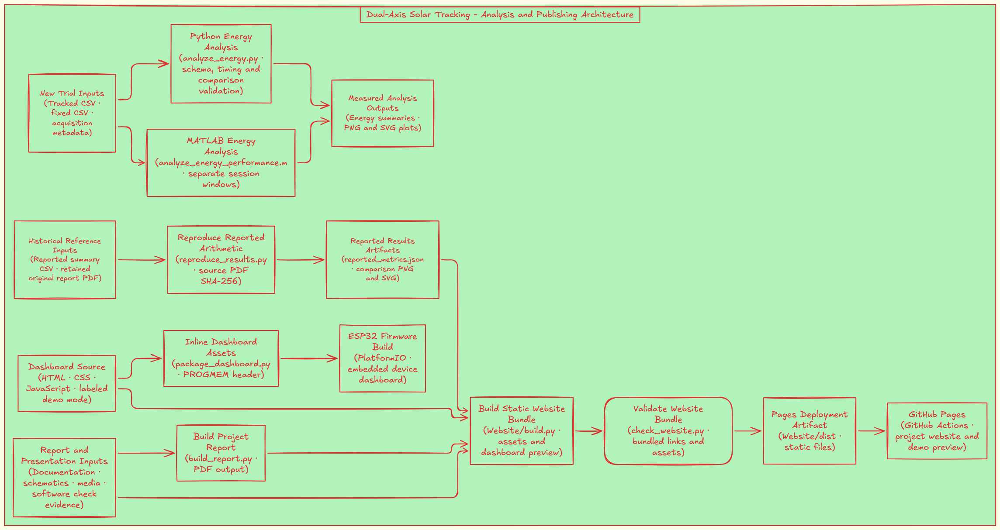

# Energy analysis



## Analyze measured sessions

```powershell
python -m pip install -r Analysis/requirements.txt
python Analysis/analyze_energy.py --tracker Data/Raw/session-001/tracker.csv --fixed Data/Raw/session-001/fixed.csv --metadata Data/Raw/session-001/metadata.json --output Analysis/Results/session-001
```

The parser validates CSV columns, strictly increasing timestamps, electrical consistency (`P = V * I`), and sample validity flags. Energy uses trapezoidal integration over valid adjacent samples no more than 2.5 s apart. Comparative gain requires equal observation durations, zero excluded intervals, and positive fixed-panel energy.

Use `--require-complete-metadata` when incomplete acquisition metadata should block summary output.

## MATLAB workflow

```matlab
addpath('Analysis/MATLAB')
summary = analyze_energy_performance('Data/Raw/session-001/tracker.csv', 'Data/Raw/session-001/fixed.csv', 'Analysis/Results/session-001');
```

## Mathematical definitions

- Power: `P_W = V * I_A`
- Energy increment: `E_Wh = sum((P_previous_W + P_current_W) / 2 * dt_s / 3600)`
- Gross energy gain: `gross_gain_pct = 100 * (E_tracked - E_fixed) / E_fixed`
- Rated-power utilization: `100 * P_W / 0.9`
