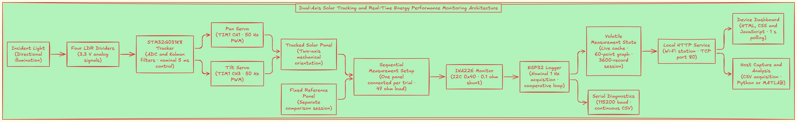
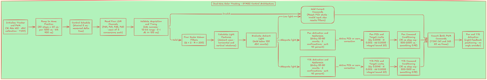
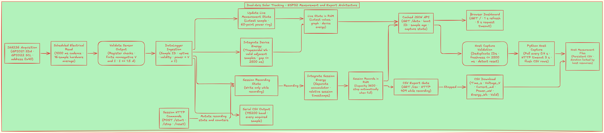
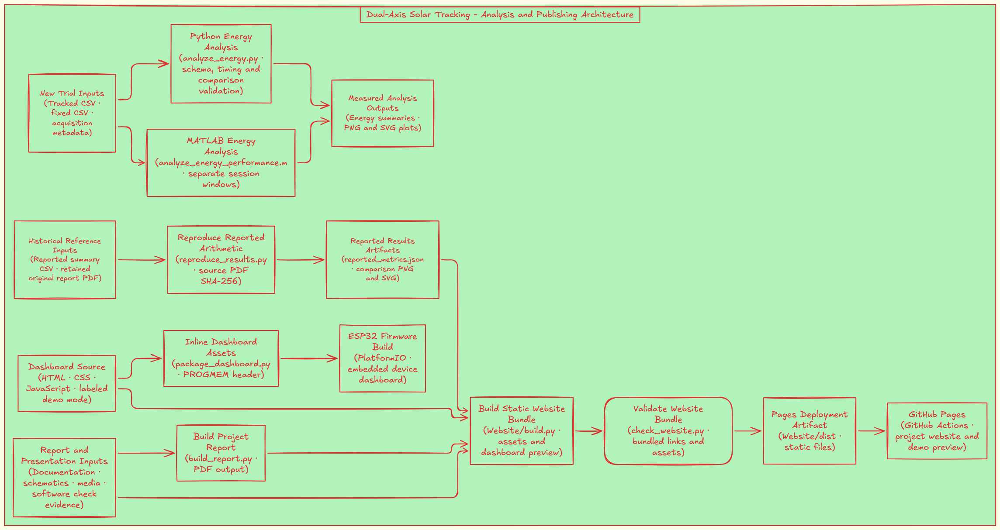

# System architecture

## Tracking subsystem

The STM32G031K8 operates at the configured 16 MHz HSI system clock. TIM1 prescaler 15 yields a 1 MHz counter; period 19,999 gives a 20 ms PWM frame. Application control is scheduled nominally every 5 ms using the millisecond tick. Actual loop duration and missed timing must be assessed on hardware.

Four ADC channels are sampled three times each. The application checks HAL status, filters each channel, derives light imbalance, and updates bounded servo commands. The controller holds position on invalid inputs or low light. There is no angle encoder and no solar-position calculation.

Application code resides in `tracking_control`, `kalman_filter`, and `ldr_sensors`; generated clock/peripheral setup remains in `main.c` and the HAL MSP source. CubeIDE regeneration markers are retained because the IDE uses them to preserve application integration.

## Measurement subsystem

The ESP32 reads one INA226 every nominal second independently of HTTP polling. Measurement feeds a device energy integrator, a 60-sample graph, and an optional 3,600-record RAM session. HTTP handlers serialize cached state. Network setup is asynchronous; INA226 initialization is retried after failures.

The application runs cooperatively. HTTP work and I2C timeouts can delay a sample; actual timestamps and gap exclusion prevent treating delayed acquisition as exact timing. The monitor uses 16-sample hardware averaging and a configured 0.1 ohm shunt range. These settings do not establish calibrated accuracy.

## Data flow and interfaces

- ADC: four light divider voltages into STM32.
- PWM: pan and tilt command pulse widths from TIM1.
- I2C: INA226 electrical measurements into ESP32.
- HTTP GET `/data`: cached measurements, validity, recording state, and sample age.
- HTTP POST `/start`, `/stop`, `/reset`: session operations.
- HTTP GET `/csv`: stopped session export.
- USB serial: continuous CSV telemetry for diagnostics.

There is no communication bridge between the MCUs. A failure in the browser does not stop acquisition, while a power/network failure can still affect the respective hardware. Volatile RAM logs are lost on reset or power loss.

## Analysis and publishing

Python and MATLAB analyze new trial files. Dashboard source is packaged into ESP32 firmware (`Tools/package_dashboard.py`) and bundled into the static website (`Website/dist/`); live measurements require the ESP32. The [GitHub Actions deployment workflow](../.github/workflows/deploy-website.yml) publishes `Website/dist` to GitHub Pages.

Open any image at full resolution for its technical labels. The authoritative architecture diagrams are maintained in `Images/`.
