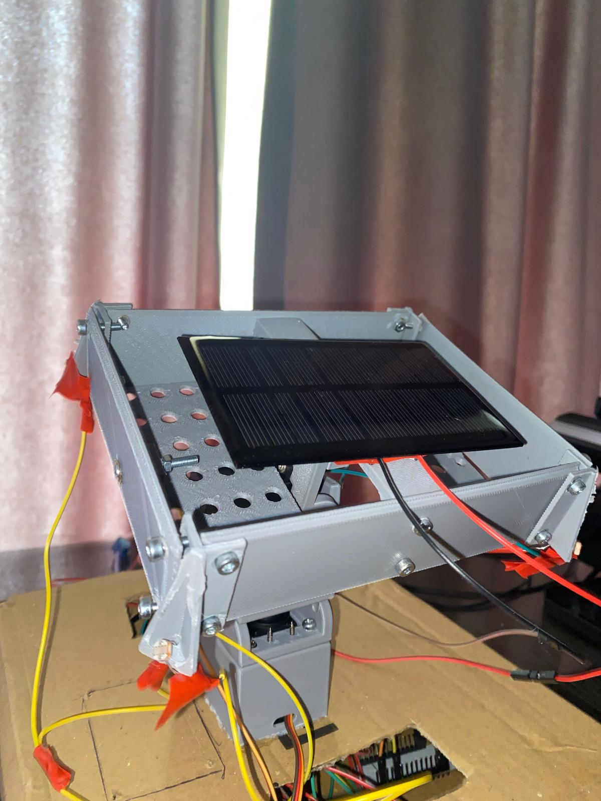

# Dual-Axis Solar Tracking and Real-Time Energy Performance Monitoring

A dual-microcontroller prototype combining STM32 LDR pan-tilt tracking with ESP32 INA226 electrical monitoring, live web dashboard, and analysis scripts.

**Author:** Aishik Tokdar  
**Technologies:** Embedded C, C++, STM32G031K8, ESP32, INA226, PID control, Kalman filtering, MATLAB, Python, HTML/CSS/JavaScript.

## Structure

- `Firmware/STM32_Tracker/` - `ldr_sensors.c`, `kalman_filter.c`, `tracking_control.c`
- `Firmware/ESP32_Logger/` - INA226 power logger, RAM session recorder, and `/data` `/csv` HTTP server
- `Dashboard/` - Local live UI packaged via `Tools/package_dashboard.py`
- `Data/` - [Measurement schema](Data/Schema.md) and long-duration sessions via `Tools/capture_session.py`
- `Hardware/` - [Pin mapping](Hardware/Pin_Mapping.md), [BOM](Hardware/BOM.csv), [schematic](Hardware/Schematics/hardware_schematic.pdf)
- `Analysis/` - [Python & MATLAB energy evaluation](Analysis/README.md)


Copy `Firmware/ESP32_Logger/secrets.example.h` to `Firmware/ESP32_Logger/secrets.h` (git-ignored) before flashing the ESP32.

## Assembly and datasets



Paired 3-hour exports (`10,801` samples) are stored in [Data](Data/README.md). See [Calibration](Hardware/Calibration.md) and the [static project website](Website/dist/index.html).

## Quick build

```powershell
python Tools/package_dashboard.py
python -m platformio run -d Firmware/STM32_Tracker
python -m platformio run -e esp32_logger
```

Updated control hysteresis (50-80 counts, 40% exit), INA226 register checks (`CheckedINA226`), dashboard freshness (`>2.5 s`), and matching `<=2.5 s` gap exclusion in Python/MATLAB analysis.
