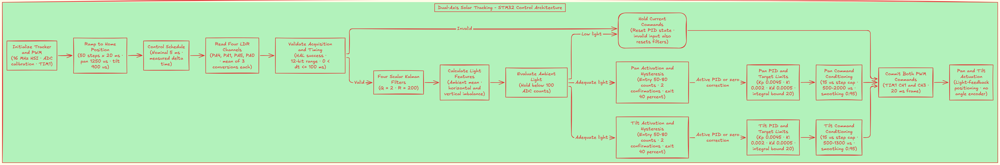
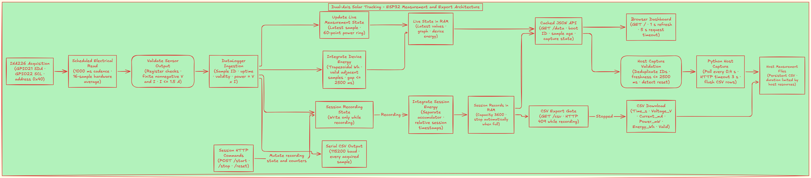
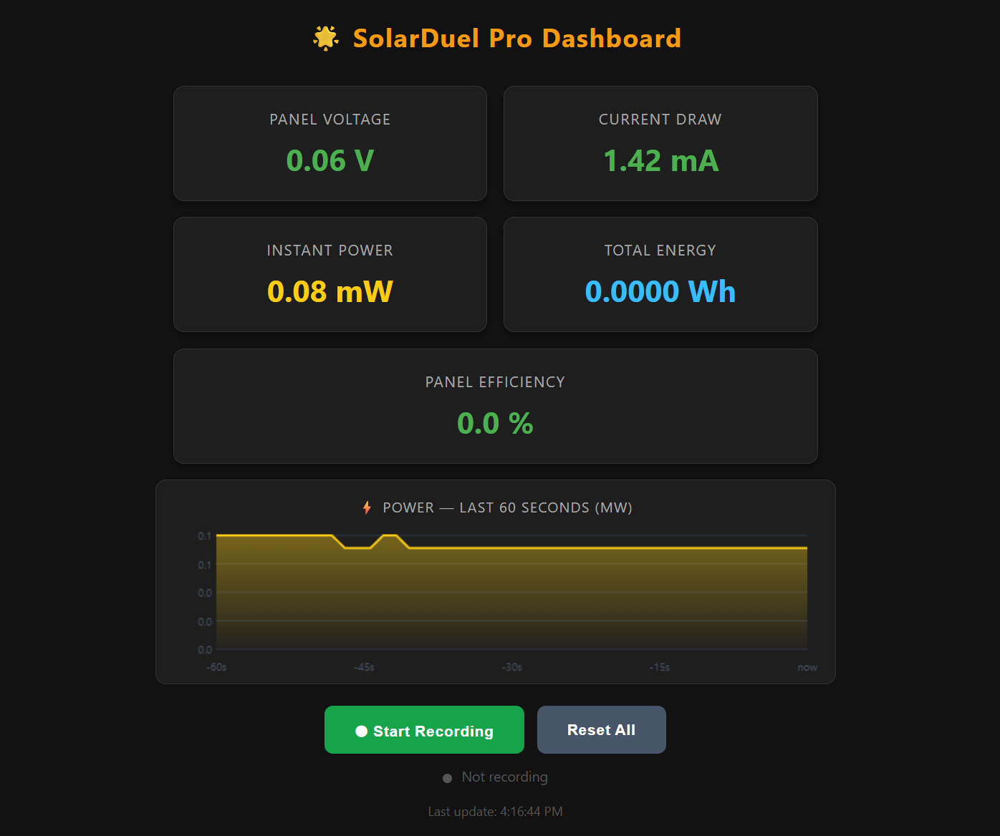
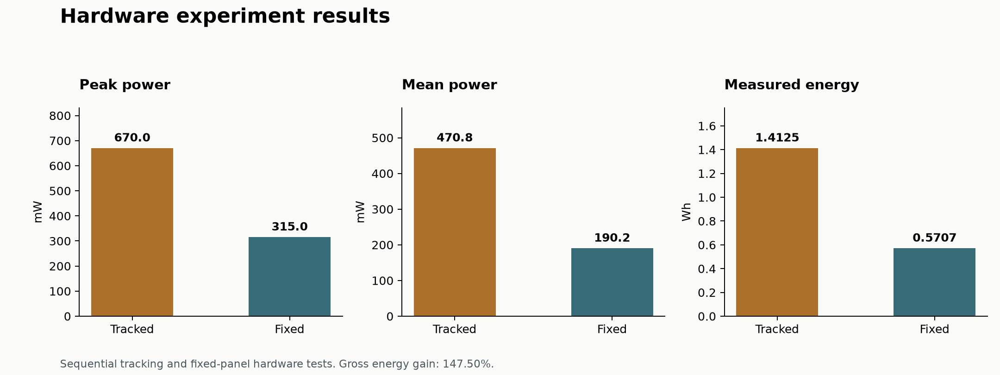

# Dual-Axis Solar Tracking and Real-Time Energy Performance Monitoring

A dual-microcontroller embedded system combining STM32 light-feedback tracking with ESP32 electrical measurements, a local dashboard, and energy performance analysis.

**Author:** Aishik Tokdar  
**Technologies:** Embedded C, C++, STM32G031K8, ESP32, INA226, PID control, Kalman filtering, MATLAB, Python, HTML/CSS/JavaScript.

[Project report](Docs/Project_Report.pdf) | [Architecture](Docs/Architecture.md) | [Control algorithm](Docs/Control_Algorithm.md) | [Hardware](Hardware/README.md) | [Demonstration](Videos/system_demonstration.mp4) | [Project website](Website/dist/index.html)

[Project website source](Website/dist/index.html) is available in `Website/`, separate from the device dashboard, and deploys via [GitHub Actions](.github/workflows/deploy-website.yml).

## Contents

1. [Overview](#1-overview)
2. [Key features](#2-key-features)
3. [System architecture](#3-system-architecture)
4. [Hardware configuration](#4-hardware-configuration)
5. [Control pipeline and flow diagram](#5-control-pipeline-and-flow-diagram)
6. [Measurement and dashboard](#6-measurement-and-dashboard)
7. [Results and evidence](#7-results-and-evidence)
8. [Mathematical definitions](#8-mathematical-definitions)
9. [Repository structure](#9-repository-structure)
10. [Setup and operation](#10-setup-and-operation)
11. [Energy analysis workflow](#11-energy-analysis-workflow)
12. [Assembly and media](#12-assembly-and-media)
13. [Limitations](#13-limitations)
14. [Authorship and license](#14-authorship-and-license)

## 1. Overview

Four light-dependent resistors detect directional light imbalance. An STM32G031K8 filters their readings and adjusts pan and tilt servo commands. A separate ESP32 acquires voltage and current through an INA226, integrates electrical energy, and presents live measurements on the local network.

Tracking operates independently of the browser. Measurements can be recorded in RAM or captured on a host computer for longer experiments. Analysis compares tracked and fixed configurations under a documented acquisition protocol.

The repository contains firmware, the web interface, schematic, mechanical assets, photos, videos, analysis, and the original technical report. The hardware experiment results are documented alongside the implemented control and measurement system.

## 2. Key features

| Area | Implementation |
|---|---|
| Direction sensing | Four LDR dividers; three ADC readings averaged per channel |
| Filtering | Independent scalar Kalman filters |
| Control | Two PID axes with filtered derivative and bounded integral |
| Stability | Adaptive tolerance, confirmation counter, separate hysteresis exit |
| Servo commands | Startup ramp, slew cap, smoothing, configured pulse limits |
| Fault behavior | Hold on invalid input, invalid timing, or low light |
| Power monitoring | INA226 voltage/current acquisition and configured 16-sample averaging |
| Energy | Trapezoidal integration; invalid and long intervals excluded |
| Interface | Responsive dashboard, cached JSON API, freshness and recording status |
| Recording | 3,600-record RAM sessions and host-side capture |
| Analysis | MATLAB and Python workflows with explicit units and validation |
| Evidence | Measured hardware results, source references, and executable software checks |

## 3. System architecture

The STM32 handles light sensing and motion commands. The ESP32 handles electrical monitoring and network access. There is no MCU-to-MCU telemetry bridge in the current design.


[Full-resolution system diagram](Images/System_Architecture.png) | [Architecture details](Docs/Architecture.md)

The diagram shows the independent control and measurement subsystems. Open the full-resolution image to inspect component details.

## 4. Hardware configuration

### 4.1 Bill of materials

| Component | Configuration | Quantity |
|---|---|---:|
| STM32 board | NUCLEO-G031K8 | 1 |
| ESP32 board | ESP32-WROOM-32 class | 1 |
| LDR sensors | GL5528-class dividers | 4 |
| Divider resistors | 10 kohm | 4 |
| INA226 | Configured 0.1 ohm shunt, address 0x40 | 1 |
| Hobby servos | Pan and tilt; verify fitted model | 2 |
| Solar panels | 6 V / 150 mA nominal | 2 |
| Load resistor | 47 ohm / 5 W; shared for sequential runs | 1 |
| Servo supply | External 5 V; original notes specify 3 A | 1 |
| Printed frame | Third-party pan-tilt assembly | 1 |

[Detailed BOM](Hardware/BOM.csv) | [Calibration](Hardware/Calibration.md)

### 4.2 Pin mapping

| Signal | Pin | Interface |
|---|---|---|
| LDR top-left | STM32 PA4 | ADC1_IN4 |
| LDR top-right | STM32 PA1 | ADC1_IN1 |
| LDR bottom-left | STM32 PA5 | ADC1_IN5 |
| LDR bottom-right | STM32 PA0 | ADC1_IN0 |
| Pan command | STM32 PA8 | TIM1_CH1 |
| Tilt command | STM32 PA10 | TIM1_CH3 |
| INA226 SDA | ESP32 GPIO21 | I2C |
| INA226 SCL | ESP32 GPIO22 | I2C |

LDR dividers use 3.3 V. Servos use an external supply and tracker ground reference. Verify polarity, voltage domains, shunt value, and actual connections before collecting data.

### 4.3 Circuit diagram

[Two-page schematic](Hardware/Schematics/hardware_schematic.pdf) | [Complete wiring notes](Hardware/Pin_Mapping.md)


These images are rendered from the retained schematic. Replace the corresponding PDF and images together when updating the wiring drawing.

## 5. Control pipeline and flow diagram



[Full-resolution STM32 diagram](Images/STM32_Architecture.png) | [Control details](Docs/Control_Algorithm.md)

1. Read and validate four ADC channels.
2. Average samples and apply per-channel Kalman filtering.
3. Calculate horizontal/vertical imbalance and ambient level.
4. Hold on invalid input or low light.
5. Activate after consecutive out-of-band readings; deactivate below the smaller exit threshold.
6. Apply PID, derivative filtering, and saturation handling.
7. Limit target movement, clamp pulse widths, smooth commands, and update PWM.

| Parameter | Configured value | Source |
|---|---:|---|
| Control schedule | 5 ms / nominal 200 Hz | [Configuration](Firmware/STM32_Tracker/Core/Inc/tracker_config.h) |
| Servo PWM frame | 20 ms / calculated 50 Hz | [Clock and timer setup](Firmware/STM32_Tracker/Core/Src/main.c) |
| Kalman Q / R | 2 / 200 | [Filter](Firmware/STM32_Tracker/Core/Src/kalman_filter.c) |
| Adaptive entry tolerance | 50-80 ADC counts | [Configuration](Firmware/STM32_Tracker/Core/Inc/tracker_config.h) |
| Exit tolerance | 40% of entry | [Configuration](Firmware/STM32_Tracker/Core/Inc/tracker_config.h) |
| Maximum target step | 15 us per update | [Configuration](Firmware/STM32_Tracker/Core/Inc/tracker_config.h) |
| Startup ramp | 50 steps x 20 ms | [Startup code](Firmware/STM32_Tracker/Core/Src/main.c) |

Configured timing and commands are distinct from measured rates or angular accuracy. Hardware diagnostic counters support validation.

## 6. Measurement and dashboard



[Full-resolution ESP32 diagram](Images/ESP32_Architecture.png)

A firmware timer drives nominal 1 Hz acquisition. Samples update cached measurements, energy integration, graph history, and active recording. HTTP reads cached state; opening more viewers does not intentionally create additional samples.

Invalid samples carry a validity flag. Integration excludes invalid adjacent samples and gaps above 2.5 seconds. Session and device energy are separate. Full RAM capacity stops recording automatically.

| Endpoint | Method | Purpose |
|---|---|---|
| `/` | GET | Embedded dashboard |
| `/data` | GET | Cached sample and capture state |
| `/start` | POST | New session |
| `/stop` | POST | Stop session |
| `/reset` | POST | Clear counters |
| `/csv` | GET | Export a stopped session |



The image retains the original dashboard appearance. The current live dashboard shows voltage, current, power, session energy, rated-power utilization, measurement freshness, and recording state.

At nominal 1 Hz, 3,600 records cover 3,599 seconds between first and last samples. RAM logs are volatile; longer trials use host capture.

[Dashboard source](Dashboard/README.md) | [CSV schema](Data/Schema.md) | [Original screenshot](Images/dashboard_original.png)

## 7. Results and evidence

**Tracked energy: 1.4125 Wh. Fixed-panel energy: 0.5707 Wh. Recalculated gross energy difference: +147.50%.**

We tested the tracking and fixed-panel configurations on hardware using the same measurement path and resistive load. The tracking panel generated 1.4125 Wh, compared with 0.5707 Wh from the fixed panel, giving a gross energy gain of 147.50%. The measurements are recorded in Table 6 of the [project report](Docs/Project_Report.pdf).

| Metric | Tracked | Fixed | Evidence |
|---|---:|---:|---|
| **Peak power** | **670.0 mW** | **315.0 mW** | [Measured results](Data/Reference/reported_summary.csv) |
| **Mean power** | **470.8 mW** | **190.2 mW** | [Measured results](Data/Reference/reported_summary.csv) |
| **Measured energy** | **1.4125 Wh** | **0.5707 Wh** | [Project report](Docs/Project_Report.pdf) |
| Peak rated-power utilization | 74.44% | 35.00% | [Measured results](Data/Reference/reported_summary.csv) |
| Mean rated-power utilization | 52.31% | 21.14% | [Measured results](Data/Reference/reported_summary.csv) |
| **Energy difference** | **+0.8418 Wh** | Reference | [Reported metrics](Analysis/Results/reported_metrics.json) |
| **Gross energy gain** | **+147.50%** | Reference | [Reported metrics](Analysis/Results/reported_metrics.json) |



The source describes sequential sessions. Its older efficiency terminology is normalized to rated-power utilization. Mean instantaneous gain and unmeasured actuator budgets are excluded from the verified energy comparison.

## 8. Mathematical definitions

| Quantity | Definition |
|---|---|
| Power | `P_W = V_V * I_A` |
| Energy increment | `(P_previous_W + P_current_W) / 2 * dt_s / 3600` |
| Gross energy gain | `100 * (E_tracked - E_fixed) / E_fixed` |
| Rated-power utilization | `100 * P_W / P_rated_W` |

The configured panel rating is 0.9 W. Conversion efficiency needs measured irradiance and panel area. Net benefit needs measured incremental actuator/control consumption. Neither follows from rated-power utilization.

## 9. Repository structure

```text
Firmware/
  STM32_Tracker/       CubeIDE project, HAL, control, filtering, ADC
  ESP32_Logger/        Measurement, energy, recording, HTTP, network
Dashboard/            Editable HTML, CSS, JavaScript
Hardware/             BOM, pins, calibration, schematic
CAD/                  Third-party STL files and credits
Data/
  Raw/                Measured session exports and metadata
  Reference/          Hardware experiment summary
Analysis/
  MATLAB/             Measured-data analysis
  Results/            Comparison figures and summary metrics
Docs/                 Architecture, control reference, and PDF report
Images/               Architecture diagrams, assembly, and dashboard images
Videos/               System demonstration video
Tools/                Host capture and dashboard packaging scripts
Website/              Static presentation site deployed via GitHub Pages
```

## 10. Setup and operation

This walkthrough goes from the unpowered hardware to a recorded CSV and an analysis result. Use the [pin table](#42-pin-mapping), [two-page schematic](Hardware/Schematics/hardware_schematic.pdf), and [assembly photos](#12-assembly-and-media) alongside these instructions. The reference command-line workflow uses Windows PowerShell; run commands from the repository root.

Before starting, have the components in [Section 4](#41-bill-of-materials), suitable jumper wires/connectors, two USB data cables, the external regulated servo supply, and a reference meter for voltage/current checks. Use the NUCLEO-G031K8's ST-Link USB connection and the ESP32 development board's USB connection. Install the board's USB driver if the computer does not detect it; identify the actual board/interface before choosing a driver. Use a local Wi-Fi network supported by the fitted ESP32, with the computer on the same network.

Install Python with pip, then prepare the software environment. The reference checks used Python 3.14; the installed Python must support the pinned analysis packages.

```powershell
python -m venv .venv
.\.venv\Scripts\Activate.ps1
python -m pip install platformio==6.2.0
python -m pip install -r Analysis/requirements.txt
```

If PowerShell blocks activation, invoke `.\.venv\Scripts\python.exe` instead of `python` in the commands below. Firmware compilers are installed by PlatformIO. Host GCC/G++ are only needed for the additional C/C++ checks in Section 11, not to collect data or run Python analysis.

### 10.1 Assemble and wire the hardware

Make connections with USB and external supplies disconnected. Board header positions and servo wire colours vary: use the board and module labels rather than guessing from wire colour or a generic pinout.

**Mechanical assembly**

1. Use the [credited frame parts and assembly notes](CAD/README.md). Check the fitted servos against the MG995-named geometry; the filenames do not guarantee compatibility with another servo model. The repository does not specify every fastener dimension, so match fasteners and mounting holes to the actual printed parts.
2. Assemble the pan base and tilt bracket, leaving the panel off for initial travel tests. Route wires with enough slack for both axes and keep them clear of joints.
3. Mount the four LDRs as a 2×2 sensing head and label them TL, TR, BL, and BR consistently with the front sensing face. Confirm each label by shading that physical sensor during the debugger checks below.
4. Review `PAN_MIN`, `PAN_MAX`, `PAN_HOME`, `TILT_MIN`, `TILT_MAX`, and `TILT_HOME` in [tracker_config.h](Firmware/STM32_Tracker/Core/Inc/tracker_config.h) against the fitted servo's supported pulse range and the mechanism. The inherited limits are not universal servo specifications. Install the panel only after the unloaded mechanism passes startup and travel tests.

**STM32 light-sensor connections**

Build four independent dividers, each with this arrangement:

```text
STM32 3V3 ── LDR ──┬── assigned ADC pin
                    └── 10 kohm resistor ── STM32 GND
```

| Divider midpoint | STM32 MCU pin |
|---|---|
| Top-left (TL) | PA4 |
| Top-right (TR) | PA1 |
| Bottom-left (BL) | PA5 |
| Bottom-right (BR) | PA0 |

Use the board header position corresponding to each MCU pin. Power these dividers from the STM32 board's **3.3 V**, not the servo rail. This divider arrangement raises the ADC reading as the LDR receives more light.

**Servo connections and power**

| Connection | Destination |
|---|---|
| Pan servo signal | STM32 PA8 / TIM1_CH1 |
| Tilt servo signal | STM32 PA10 / TIM1_CH3 |
| Both servo supply positives | External regulated 5 V supply positive, if compatible with the fitted servos |
| Both servo grounds | External supply negative and STM32 GND |
| STM32 board power | Its normal USB/ST-Link supply during this walkthrough |

The original build specifies a 5 V / 3 A servo supply; confirm that it supports the fitted motors and their startup/stall demand. Power the servos from that external rail, not an MCU 3V3 pin or through the board's small regulator. Keep the external 5 V positive separate from the 3.3 V sensor rail. Leave servo power off while flashing and checking the controller initially.

**ESP32 and INA226 connections**

| INA226 connection | Destination |
|---|---|
| VCC | ESP32 3V3 |
| GND | ESP32 GND and measurement return |
| SDA | ESP32 GPIO21 |
| SCL | ESP32 GPIO22 |
| Address straps | Configuration that selects `0x40` on the fitted module |

Power the ESP32 development board through USB. Keep I2C pull-ups in the 3.3 V domain. Verify the breakout's actual shunt value against `SHUNT_OHMS=0.1` in [config.h](Firmware/ESP32_Logger/config.h); update the configuration if the fitted shunt differs.

**Panel, shunt, and load connections**

The retained logger schematic uses this current path:

```text
Selected panel + ── INA226 IN+ ── module shunt ── IN− ── 47 ohm / 5 W load ── panel −
Selected panel − ── INA226 GND ── ESP32 GND
INA226 VBUS/VBS ── selected panel + / IN+ node, as shown in the schematic
```

Check the actual breakout labels and any onboard VBUS connections before wiring; modules can route the bus-voltage input differently. In the retained schematic VBUS senses the panel side of the shunt, so `voltage × current` describes that monitored boundary, including the shunt's small voltage drop relative to the load. Record the voltage-sense location when documenting a run.

Use one selected panel at a time with the shared monitor and 47 ohm load. The other panel is measured in a separate session. The solar panel is the measured source; it does not directly power the MCU boards or servos in this setup. There is no STM32-to-ESP32 signal cable or telemetry link to add: the STM32 controls motion, while the ESP32 measures electrical output independently.

### 10.2 Build, flash, and check the tracker

Connect only the STM32 USB/ST-Link interface initially, keeping servo power off. Build and upload using the pinned configuration:

```powershell
python -m platformio run -d Firmware/STM32_Tracker
python -m platformio run -d Firmware/STM32_Tracker -t upload
```

STM32CubeIDE is an alternative: import the existing `Firmware/STM32_Tracker` project and retain its application modules and USER CODE sections. CubeMX regeneration is not required for this walkthrough.

Use the debugger to inspect `tracker.filters[0].x` through `tracker.filters[3].x` and confirm the filtered quadrant readings change when the corresponding LDR is shaded. Inspect `tracker.valid` as well; raw `readings` can be inspected at a breakpoint after `LDR_ReadAll` in `main.c`. The application samples in TL, TR, BL, BR order. The STM32 firmware does not print a continuous LDR diagnostic stream or send it to the ESP32; use its debugger for this check.

After checking wiring and the fitted servo limits, disconnect power, connect the unloaded servos, and power the controller and external servo rail. Keep the mechanism clear: the firmware commands its configured startup range and ramps to the home values on boot. Test small light offsets on each axis. The panel mount should turn toward the brighter side, and equal illumination or low light should hold the command.

If an axis moves away from light, first verify physical quadrant labels. If the mount reverses the required command direction, adjust the corresponding error sign in [tracking_control.c](Firmware/STM32_Tracker/Core/Src/tracking_control.c), rebuild, and repeat the unloaded tests. There is no direction-switch setting in `tracker_config.h`; that file contains the pulse limits and tuning constants. Once direction and travel are correct, power off, secure the panel, and repeat the clearance test with its load.

### 10.3 Build, flash, and connect to the logger

Copy the Wi-Fi template once, then edit the new private file with the local SSID and password:

```powershell
Copy-Item Firmware/ESP32_Logger/secrets.example.h Firmware/ESP32_Logger/secrets.h
```

`secrets.h` stays in `Firmware/ESP32_Logger/` and is ignored by Git. Do not leave the placeholder credentials unchanged. Package the dashboard, connect the ESP32 through a USB data cable, and identify its port:

```powershell
python Tools/package_dashboard.py
python -m platformio device list
python -m platformio run -e esp32_logger
```

Replace `COM7` below with the ESP32 port reported on your computer. On other systems the port name differs. Select the ESP32 port, not the STM32 virtual COM interface.

```powershell
python -m platformio run -e esp32_logger -t upload --upload-port COM7
python -m platformio device monitor --port COM7 -b 115200
```

Close the serial monitor with Ctrl+C before another upload. If the upload cannot open the port, close other applications using it. Some development boards need their documented BOOT/reset sequence to enter the uploader; follow the fitted board's procedure.

The Arduino sketch can also be opened in Arduino IDE with its adjacent `.cpp/.h` files, ESP32 board support, and INA226_WE installed. The pinned PlatformIO configuration is the reproducible reference build.

When Wi-Fi connects, the serial output prints `Dashboard: http://<device-ip>`. Read the actual address from that message or the router's client list. Open it in a browser on the same local network. Use the device's IP address: the HTTP server checks the Host header and does not accept arbitrary DNS names. It does not create a setup access point automatically. Use a trusted local network; the dashboard has no user login.

### 10.4 Verify live readings and calibrate

Before recording a comparison:

1. Confirm the dashboard shows **Live**, a fresh sample, and plausible voltage/current/power with the panel and load connected. Acquisition is nominally once per second; opening the browser does not initiate samples.
2. Compare voltage and current against a reference meter or calibrated measurement channel at several relevant operating points. Verify shunt polarity and near-zero offset. Record observations in a copy of [calibration_template.csv](Hardware/calibration_template.csv), including reference-instrument identity, units, date, and the actual firmware revision. Save that record outside `Data/Raw/`, for example as `Hardware/Calibration_Records/run-002.csv`, and put its location in the session metadata.
3. Record the fitted panel identifiers/nameplate ratings, shunt value, load, and voltage-sense location. The configured 0.9 W panel rating and 0.1 ohm shunt are defaults to verify, not calibration results.
4. Complete the [light-sensor and servo checks](Hardware/Calibration.md). Keep supply and mechanics stable before starting a trial.

`Power_mW = Voltage_V × Current_mA`. The ESP32 integrates power over actual timestamps using the trapezoidal rule. Invalid samples and intervals above 2.5 seconds are excluded. **Device energy** accumulates since its counter was reset; **session energy** starts with dashboard recording. A host capture retains the device counter but analysis calculates energy for the captured window. These totals need not start at the same value.

### 10.5 Create the run folder and acquisition notes

Use a new folder for each comparison; do not overwrite the supplied `session-001` files. This example uses `run-002` throughout:

```powershell
$runFolder = "Data/Raw/run-002"
if (Test-Path -LiteralPath $runFolder) { throw "Choose an unused run folder first" }
New-Item -ItemType Directory -Path $runFolder | Out-Null
Copy-Item Data/session_metadata.example.json "$runFolder/metadata.json"
```

Edit `metadata.json` before collection, then complete it after the runs:

| Metadata | What to record |
|---|---|
| `session_id`, `protocol` | `run-002` and `sequential` for the single-monitor workflow |
| `panel_identifiers` | Actual tracked and fixed panel labels/serials; retain the same identities across both runs |
| `panel_rated_w`, `load_ohms`, `shunt_ohms` | Verified nameplate/configuration values and their source in `parameter_sources` |
| `tracker_start_utc`, `fixed_start_utc`, `local_timezone` | Time corresponding to CSV `Time_s=0`, with timezone and a documented timing basis |
| `fixed_azimuth_deg`, `fixed_tilt_deg` | Measured fixed-panel orientation; record the azimuth reference and method in the notes |
| `firmware_revision`, `acquisition_method` | Actual flashed commit/build identifier and `device_ram_csv` or `host_capture` |
| `calibration_record`, `weather_and_shading` | Retained calibration-file location and observed conditions for each trial |
| `processing_history`, `duration_s` | Confirmed processing history and actual first-to-last coverage, not just the requested duration |

Use JSON `null` for unknown facts. If both records are unchanged, explicitly record that in `processing_history`; if they are trimmed or otherwise processed, keep originals and record the operation. Copying a field from the current source does not prove that firmware was used for a historical measurement. For a Git checkout with a recorded commit, `git rev-parse HEAD` gives its identifier; if there is no commit yet, retain a build/source identifier rather than inventing one. Record both board builds if they differ. The files produced by the reference builds can also be identified with their actual hashes:

```powershell
Get-FileHash .pio/build/esp32_logger/firmware.bin -Algorithm SHA256
Get-FileHash Firmware/STM32_Tracker/.pio/build/stm32_tracker/firmware.elf -Algorithm SHA256
```

Retain the hash of the artifact that was actually flashed, together with any source/configuration changes; a later rebuild can have a different identity.

The firmware CSV has elapsed timestamps, not an absolute clock. Record acquisition time with a documented independent timing basis. Host sidecars record capture and receipt times, which must not be presented as exactly synchronized sensor timestamps. Keep unknown acquisition times null instead of substituting file-save or export times.

Choose **one** of the following recording methods for both panel trials. Keep the measurement boundary, load, and nominal observation duration the same. Record the tracked run, stop and save it, then disconnect power before moving the shared measurement path to the fixed panel. Record the new panel identity, fixed orientation, conditions, and start time before the second run. Separate sessions have different weather/time-of-day conditions; a common elapsed-time axis does not make them simultaneous.

### 10.6 Short recording: dashboard to CSV

1. Open `http://<device-ip>` and check fresh valid measurements.
2. If an older session exists, export it first. Press **Reset** only after it has been saved; reset clears RAM data and energy counters.
3. Press **Start**. The next firmware sample becomes the first recorded sample and establishes CSV `Time_s=0`. Keep the browser or return later; acquisition continues without browser polling.
4. Press **Stop** at the chosen duration. The buffer also stops automatically when full.
5. Use the **Export CSV** control and save the downloaded file as `Data/Raw/run-002/tracker.csv`. A browser may download it as `solar_session.csv`; move/rename that file without opening and resaving its numeric contents in a spreadsheet.
6. For the fixed-panel trial, save the old recording, reset, repeat the acquisition with the fixed panel, then save its export as `Data/Raw/run-002/fixed.csv`.

The RAM limit is 3,600 samples: nominal first-to-last coverage is 3,599 seconds, just under one hour. A new Start refuses to replace an existing session until Reset. Export requires stopped recording. Rebooting or powering off loses unexported RAM records. Use host capture for a three-hour trial.

### 10.7 Longer recording: host capture to CSV

Keep the computer awake and the ESP32 reachable on the same network. Replace `<device-ip>` with its actual address. The commands create new files and refuse existing output filenames.

For the tracked run, with `metadata.json` already filled with the conditions known at that time:

```powershell
python Tools/capture_session.py --url http://<device-ip> --duration 10800 --output Data/Raw/run-002/tracker.csv --metadata-output Data/Raw/run-002/tracker.capture.json --context Data/Raw/run-002/metadata.json
```

Stop the first capture before changing the measurement setup. Record the fixed-panel conditions in `metadata.json`, then capture the fixed run:

```powershell
python Tools/capture_session.py --url http://<device-ip> --duration 10800 --output Data/Raw/run-002/fixed.csv --metadata-output Data/Raw/run-002/fixed.capture.json --context Data/Raw/run-002/metadata.json
```

Dashboard **Start** is not required for this method. The script polls cached `/data` samples and writes new, fresh snapshots directly to disk, independent of the RAM recording limit. Do not reset device counters during a capture. A detected reboot, counter reset, or inconsistent clock stops the capture; preserve its partial files and start a new run/file rather than appending across the boundary. Ctrl+C stops a capture and preserves what was recorded.

Each `.capture.json` stores the notes supplied at that capture, UTC host capture/first-receipt times, boot identifier, sample count, status, elapsed coverage, and CSV SHA-256. These sidecars supplement the paired-session `metadata.json`; they do not replace it. Review their status and any terminal gap messages. Network losses remain missing intervals. A 10,800-second command does not guarantee exactly 10,800 seconds of usable sample coverage, and separately started commands need not produce equal observation windows.

### 10.8 Check and register the CSVs

After either recording method, the run should contain:

```text
Data/Raw/run-002/
  tracker.csv
  fixed.csv
  metadata.json
  tracker.capture.json   # if host capture was used
  fixed.capture.json     # if host capture was used
```

Both measurement CSVs must use the [schema](Data/Schema.md):

```text
Time_s,Voltage_V,Current_mA,Power_mW,Energy_Wh,Valid
```

Keep the original headers and units. Invalid measurements have blank electrical fields and `Valid=0`; do not replace them with zero readings. Do not confuse mA/mW with A/W or append CSVs across reboots. The separate supplied integration check is not a substitute for a panel measurement or physical calibration.

When both CSVs are final, add their identities to `metadata.json`. This PowerShell block computes the hashes from the saved files; rerun it only after a deliberately documented change to those files:

```powershell
$runFolder = "Data/Raw/run-002"
$metadataPath = (Resolve-Path "$runFolder/metadata.json").Path
$metadata = Get-Content -LiteralPath $metadataPath -Raw | ConvertFrom-Json
$files = @{}
foreach ($role in @("tracker", "fixed")) {
    $files[$role] = @{
        path = "$role.csv"
        sha256 = (Get-FileHash -LiteralPath "$runFolder/$role.csv" -Algorithm SHA256).Hash.ToLowerInvariant()
    }
}
$metadata | Add-Member -NotePropertyName files -NotePropertyValue $files -Force
$json = $metadata | ConvertTo-Json -Depth 10
[IO.File]::WriteAllText($metadataPath, $json, [Text.UTF8Encoding]::new($false))
```

The final write uses UTF-8 without a BOM so the metadata is readable by the Python tools on both Windows PowerShell and PowerShell 7. Hashes identify bytes; they do not prove measurement accuracy. Calibration observations use a different CSV schema: keep them outside `Data/Raw/` and reference their actual location in `calibration_record`; do not register them as a panel-role measurement CSV.

### 10.9 Analyze and use your CSVs

Run analysis on the two saved measurements and their completed metadata:

```powershell
python Analysis/analyze_energy.py --tracker Data/Raw/run-002/tracker.csv --fixed Data/Raw/run-002/fixed.csv --metadata Data/Raw/run-002/metadata.json --output Analysis/Results/run-002
```

The tool validates columns, units, timestamps, metadata, and declared input hashes. It calculates energy from the power samples, prints acquisition warnings, and writes:

| Output | How to use it |
|---|---|
| `Analysis/Results/run-002/summary.json` | Read `tracker`/`fixed` energy, peak and time-weighted mean power, elapsed/covered duration, and excluded intervals. Check `data_quality` and retained `acquisition_metadata` before interpreting `gross_energy_gain_pct`. |
| `Analysis/Results/run-002/energy_performance.png` | View the power histories and integrated-energy comparison. |
| `Analysis/Results/run-002/energy_performance.svg` | Use the vector version of the same chart. |

Comparison requires equal observation durations, no excluded intervals, and positive fixed-panel energy. If the command rejects unequal windows or gaps, leave the original run intact and create a separate derived-session folder with the selected tracked/fixed windows and its own metadata. Document source paths/hashes, selection boundaries, and time offsets, then register the derived files with the same hash step. If equal complete valid windows cannot be selected, collect another comparison or inspect the sessions separately instead of forcing a comparative result. Do not fill missing readings to force a passing comparison. A simultaneous comparison additionally requires synchronized absolute windows and suitable acquisition hardware; the single-monitor walkthrough uses sequential runs.

Add `--require-complete-metadata` when unresolved metadata or compatibility warnings should stop output. The default permits numerical analysis with the caveats attached; it does not turn incomplete acquisition records into verified experiments. A net-energy comparison additionally requires measured actuator/control energy.

Compare the curated session outputs using the same numerical workflow:

```powershell
python Analysis/analyze_energy.py --tracker Data/Raw/session-001/tracker.csv --fixed Data/Raw/session-001/fixed.csv --metadata Data/Raw/session-001/metadata.json --output Analysis/Results/session-001
```

See [data organization](Data/README.md) and [analysis instructions](Analysis/README.md). The supplied panel files each contain 10,801 samples over 10,800 seconds; read their [metadata](Data/Raw/session-001/metadata.json) for acquisition details.

### 10.10 View the project website

The live hardware dashboard is served at the ESP32 IP address. The repository's static presentation website does not acquire live panel readings. To preview it locally:

```powershell
python -m http.server 8000 --directory Website/dist
```

Open `http://localhost:8000` to preview the static bundle locally. Pushing changes under `Website/dist/` to `main` triggers the GitHub Pages workflow.

### 10.11 Troubleshooting the full path

| Symptom | What to check |
|---|---|
| USB board/port missing | Data-capable cable, correct USB connector, board-specific driver, and `python -m platformio device list`. |
| Upload cannot open COM port | Select the ESP32 port and close its serial monitor or other port users. STM32 uses ST-Link for upload. |
| ESP32 never prints a dashboard address | Actual `secrets.h` credentials, compatible local Wi-Fi, router association, and serial baud 115200. |
| Browser cannot open the device | Same network, correct current IP, and no client isolation between browser and logger. The presentation website is not the device server. |
| Sensor unavailable or invalid | INA226 VCC/GND, SDA/SCL, address straps, fitted shunt/configuration, current polarity, and voltage-sense node. |
| Servos reset the board or move incorrectly | External supply/ground wiring, supported pulse limits, quadrant labels, mounting direction, and mechanical clearance. |
| Start/export disabled | Export any previous session before Reset; Start requires an empty session and export requires stopped recording. |
| Capture says file exists | Preserve the earlier capture and choose a new run directory/output name. |
| Analysis rejects data | CSV schema and units, reset/decreasing timestamps or energy, equal valid durations, gaps, protocol, and metadata/hash mismatch. |
| Acquisition warnings remain | Supply actual acquisition notes and firmware/processing history. Do not change recorded values or invent metadata to clear a warning. |

## 11. Energy analysis workflow


[Full-resolution analysis and publishing diagram](Images/Project_Final_Analysis.png).

```powershell
python -m pip install -r Analysis/requirements.txt
python Analysis/analyze_energy.py --tracker Data/Raw/run/tracker.csv --fixed Data/Raw/run/fixed.csv --metadata Data/Raw/run/metadata.json --output Analysis/Results/run
```

The [deployment workflow](.github/workflows/deploy-website.yml) publishes `Website/dist/` directly to GitHub Pages.

For MATLAB:

```matlab
addpath('Analysis/MATLAB')
analyze_energy_performance('Data/Raw/run/tracker.csv', 'Data/Raw/run/fixed.csv', 'Analysis/Results/run');
```

[Analysis instructions](Analysis/README.md) | [Data organization](Data/README.md)

## 12. Assembly and media


[System demonstration video](Videos/system_demonstration.mp4)

Original print notes specify PLA and 15% infill. Verify part fit and orientation for the fitted servos and panel.

[Assembly details](CAD/README.md) | [CAD credits](CAD/ATTRIBUTION.md)

## 13. Limitations

The hardware results were obtained in sequential tracking and fixed-panel sessions. Weather differences between sessions are part of the experimental conditions. The fixed load does not establish maximum available panel power. Irradiance, panel angle, and actuator energy are not measured.

Nominal cadence does not establish measured jitter or accuracy. RAM capture is limited and volatile; use [host capture](Tools/capture_session.py) for multi-hour trials.

## 14. Authorship and license

Project author: **Aishik Tokdar**.

STL assets credit the original designer of [Solar Tracker Tilt/Pan Panel Frame LDR Mounts Rig](https://www.instructables.com/SOLAR-TRACKER-TILTPAN-PANEL-FRAME-LDR-MOUNTS-RIG/). They retain their source terms and are not claimed as original CAD.

Project software uses the [MIT license](LICENSE). Vendor code and dependencies (STM32 HAL, CMSIS, INA226_WE, and Arduino/ESP32 frameworks) retain their notices and licenses; the root license does not relicense third-party CAD.
