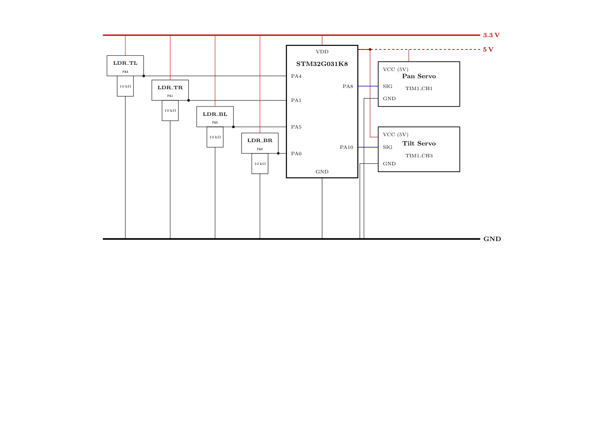

# Dual-Axis Solar Tracking and Real-Time Energy Performance Monitoring

A dual-microcontroller prototype combining STM32 LDR pan-tilt tracking with ESP32 INA226 electrical monitoring, live web dashboard, and analysis scripts.

**Author:** Aishik Tokdar  
**Technologies:** Embedded C, C++, STM32G031K8, ESP32, INA226, PID control, Kalman filtering, MATLAB, Python, HTML/CSS/JavaScript.

## Structure

- `Firmware/STM32_Tracker/` - `ldr_sensors.c`, `kalman_filter.c`, `tracking_control.c`
- `Firmware/ESP32_Logger/` - INA226 power logger, RAM session recorder, and `/data` `/csv` HTTP server
- `Dashboard/` - Local live UI packaged via `Tools/package_dashboard.py`
- `Hardware/` - [Pin mapping](Hardware/Pin_Mapping.md), [BOM](Hardware/BOM.csv), [schematic](Hardware/Schematics/hardware_schematic.pdf)
- `Analysis/` - [Python & MATLAB energy evaluation](Analysis/README.md)




## Quick build

```powershell
python Tools/package_dashboard.py
python -m platformio run -d Firmware/STM32_Tracker
python -m platformio run -e esp32_logger
```
